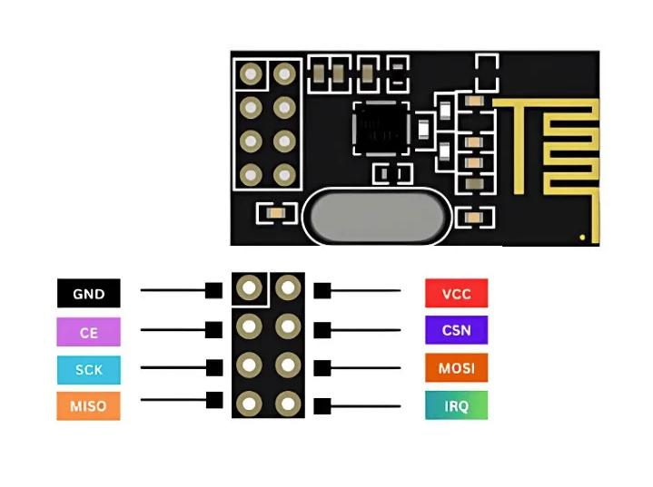
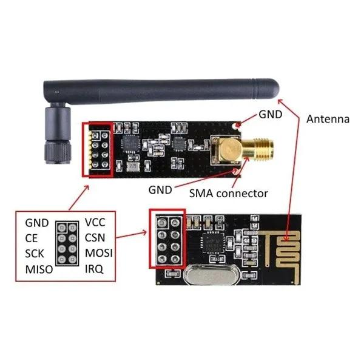

# nrf24-driver

A lightweight, platform-independent Rust driver for nRF24L01+ compatible 2.4 GHz radio transceivers.

Part of the [LE ROVE](../README.md) railway simulation and physical train project.

## Overview

The goal of this crate is to provide a reusable, `no_std` driver for communicating with nRF24L01+ compatible RF modules over SPI.

The driver is designed to be independent of any specific microcontroller or hardware abstraction layer (HAL), using the [`embedded-hal`](https://github.com/rust-embedded/embedded-hal) traits.

Target platforms include:

- ESP32-C3 — initial development platform
- ESP32-S3
- Raspberry Pi Pico 2 W (RP2350)

**Hardware status:** The initial module is believed to be an nRF24L01+ PA/LNA variant with an external SMA antenna. Its exact chip identity has not yet been independently confirmed.

## Hardware

### RF module

The module uses a 2×4 pin connector with SPI, power and control signals.





### Pin descriptions

| Pin | Direction (relative to RF module) | Description |
|---|---|---|
| VCC | Power | 3.3 V supply |
| GND | Ground | Common ground |
| CE | Input | Chip Enable, controls RX/TX operation |
| CSN | Input | Active-low SPI chip select |
| SCK | Input | SPI clock |
| MOSI | Input | SPI data from microcontroller |
| MISO | Output | SPI data to microcontroller |
| IRQ | Output | Active-low interrupt, optional |

**Warning:** Do not connect VCC to 5 V. Verify the pinout before powering an unfamiliar module.

### Initial wiring — Seeed XIAO ESP32-C3

| RF module | XIAO ESP32-C3 | Wire color |
|---|---|---|
| VCC | 3V3 | Red |
| GND | GND | Black |
| CE | D2 / GPIO4 | Yellow |
| CSN | D3 / GPIO5 | Purple |
| SCK | D8 / GPIO8 | Blue |
| MOSI | D10 / GPIO10 | Orange |
| MISO | D6 / GPIO21 | Gray |
| IRQ | Not connected | — |

**Note:** MISO was originally connected to GPIO9, but this interfered with the ESP32-C3 boot process. Moving MISO to GPIO21 resolved the issue.

## Architecture

The driver will use `embedded-hal` interfaces for SPI and GPIO operations.

```text
          Train / Station Firmware
                    |
          +---------+---------+
          |                   |
   le-rove-protocol      nrf24-driver
   Encode / Decode       Radio control
          |                   |
          |              embedded-hal
          |                   |
          |            Platform-specific HAL
          |                   |
          +---------+---------+
                    |
              RF hardware
```

The driver must not depend on `le-rove-protocol`, `metro-core`, or a specific microcontroller HAL.

Its responsibility is to configure the transceiver and send or receive byte payloads. Application-level message encoding, decoding and railway behavior belong to other crates.

## Development status

### Completed hardware experiments

- [x] Power module from ESP32-C3 at 3.3 V
- [x] Initialize SPI at 500 kHz, Mode 0
- [x] Read `STATUS` register (`0x0E`)
- [x] Read `CONFIG` register (`0x08`)
- [x] Read `RF_CH` original value (`0x02`)
- [x] Write `RF_CH = 0x32` and verify readback
- [x] Restore `RF_CH = 0x02` and verify readback

These experiments confirm SPI register read/write behavior consistent with the nRF24L01+ register interface. They do not establish RF transmission or reception functionality.

### Planned driver milestones

- [ ] Implement register read/write operations
- [ ] Add host-side unit tests using mock SPI
- [ ] Integrate the driver with ESP32-C3 firmware
- [ ] Configure RF operating parameters
- [ ] Implement TX FIFO operations
- [ ] Transmit a test payload
- [ ] Implement reception and IRQ handling
- [ ] Validate communication between two physical nodes

## Design principles

- **`no_std`** — No standard-library dependency in the driver
- **Portable** — Compatible with multiple microcontroller HALs
- **Allocation-free** — Fixed-size buffers, no heap required
- **Hardware-independent** — No direct dependencies on `esp-hal` or `rp235x-hal`
- **Testable** — SPI and GPIO interactions can be tested with mocks
- **Small API** — Introduce functionality incrementally as hardware experiments require it

## Building

Run host-side checks from the crate directory:

```bash
cargo check
cargo test
```

Embedded firmware builds are managed by their respective consuming projects, such as `train-esp32c3`.

## License

To be determined.